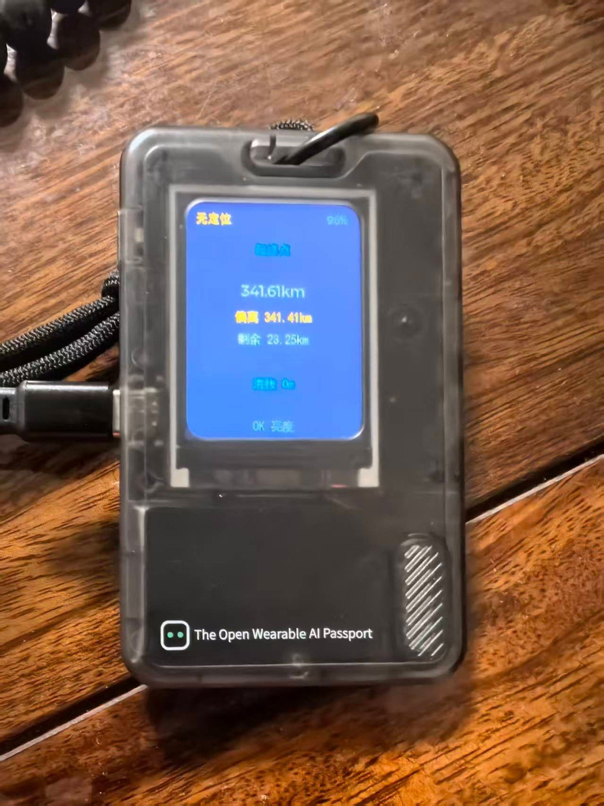
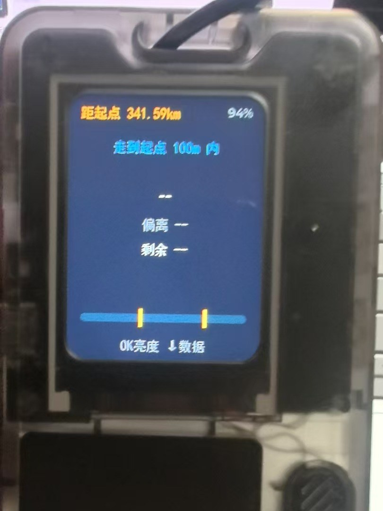
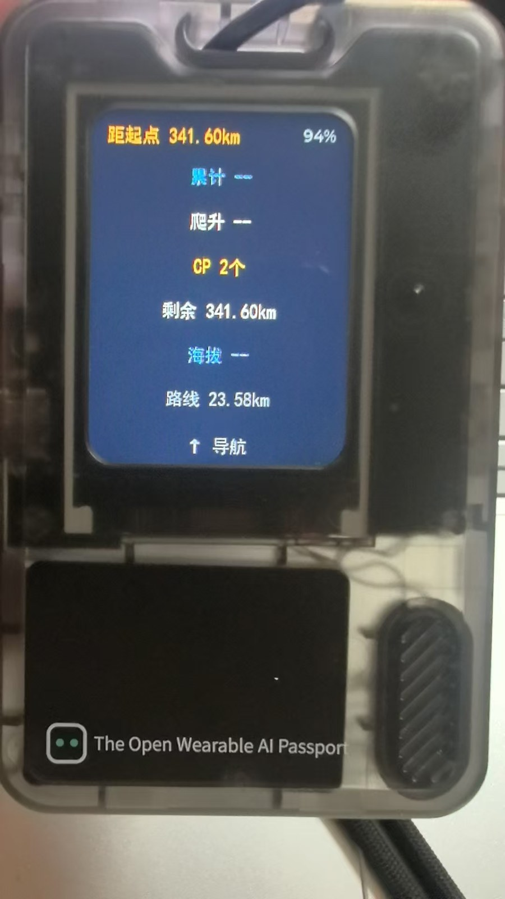
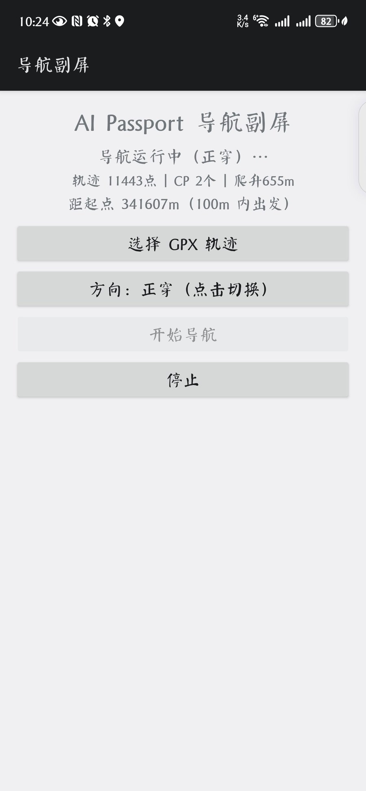

# Trail Nav Companion

<p align="center">
  
</p>

<p align="center">
  Turns the AI Passport card into a navigation companion for trail running<br>
  Distance to the next checkpoint · Drift from the route · Distance left · Altitude
</p>

<p align="center">
  <a href="README.md">简体中文</a> ·
  <a href="CHANGELOG.md">Changelog</a> ·
  <a href="docs/02-ble-protocol.md">BLE protocol</a> ·
  <a href="docs/03-build.md">Build</a>
</p>

---

## Why

On a trail run, the most expensive mistake is a wrong turn — two extra kilometres can cost you the cut-off.

At a fork, in dense forest, or halfway up a climb, pulling out your phone to check the route is slow and risky: your hand blocks the view while the ground is still loose underfoot. A phone is great at routing, but its screen is never where you need it.

This project turns the AI Passport card into a **read-only companion screen**: the phone stays in your pocket reading the GPX and doing the maths, while the card receives the results over BLE and shows the numbers you actually need in one glance.

## Features

| Feature | Description |
|---|---|
| **Start-line anchoring** | Recording begins only after you enter a 100 m circle around the start and confirm twice, so warm-up and photos never inflate your distance |
| **Forward / reverse** | The same GPX works in either direction; remaining distance and checkpoint order flip with your direction of travel |
| **Checkpoint progress bar** | Checkpoints are detected from named GPX waypoints (start and finish excluded), drawn as amber ticks on a progress bar along the bottom |
| **Next checkpoint / finish** | The big number shows distance along the route to the next checkpoint, switching to distance to finish after the last one |
| **Three-level drift** | Green under 30 m, amber beyond, red beyond 100 m, with a beep |
| **Holds the last fix** | A brief signal loss keeps the last reading and turns it amber — you can tell the numbers are getting old |
| **Stats page** | Press up/down: distance covered, ascent, checkpoint count, remaining, altitude, route length |
| **Self-checking maths** | Covered + remaining should equal the route length, so you can verify the numbers on the spot |
| **Chinese UI** | A self-generated GB2312 bitmap font (7726 glyphs) — no system font dependency |

## Screens

<p align="center">
  
  
  
</p>

<p align="center">
  <sub>Navigation page (bar + two checkpoint ticks) · Stats page · Phone app</sub>
</p>

## Architecture

```
┌─────────────────────────┐        BLE (GATT)        ┌──────────────────────────┐
│  Android phone           │  ───────────────────────▶ │  AI Passport card         │
│  · parses GPX            │  NAV|<fix>|<state>|...    │  ESP32-C3 / 8 MB flash    │
│  · GPS (2 s / 2 m)       │                          │  240×320 ST7789 LCD       │
│  · drift/remaining/CP    │ ◀─────────────────────── │  3 buttons (ADC ladder)   │
│  · foreground service    │   STAT (readable)         │  NimBLE, no GPS, no motor │
└─────────────────────────┘                          └──────────────────────────┘
      the phone does the maths                              the card does the display
```

The card computes nothing — no GPS, no map, only frame parsing and rendering. The phone makes no display decisions — fonts, colours and paging live on the card.

See [docs/01-architecture.md](docs/01-architecture.md) for the full design and [docs/02-ble-protocol.md](docs/02-ble-protocol.md) for the frame format.

## Repository layout

```
nav-companion/
├── firmware/              ESP-IDF project (fork of the AI Passport template)
│   ├── main/              nav_app / nav_ble / nav_protocol / nav_state / nav_ui / nav_format
│   ├── components/bsp/    board support (display, buttons, audio, battery)
│   ├── tests/             host-side unit tests
│   └── sdkconfig.defaults UTF-8 and CJK font configuration
├── android/               Android app (Kotlin, no third-party runtime dependencies)
│   └── app/src/main/java/com/folotoy/navcompanion/
├── docs/                  Documentation and screenshots
├── tools/                 Developer helper scripts
└── CHANGELOG.md
```

## Download and install

Pick either route — both ship the **same version** (firmware and app must match, protocol v0.3).

> The CDN links below go through jsDelivr, which is usually faster than a direct GitHub download; the `GitHub` links point at the raw file in the repository.

### Route 1: from GitHub

> Direct GitHub downloads can be slow depending on your network, so each file has two links: `CDN` goes through jsDelivr, `GitHub` points at the raw file in the repo.

| File | Download | Size |
|---|---|---|
| **Firmware** (merged image) | [CDN](https://cdn.jsdelivr.net/gh/B3DDD/nav_companion_AIPASSPORT@main/dist/folotoy-ai-passport-nav-v0.3.bin) · [GitHub](dist/folotoy-ai-passport-nav-v0.3.bin) | 2.0 MB |
| **App** (Android 12+) | [CDN](https://cdn.jsdelivr.net/gh/B3DDD/nav_companion_AIPASSPORT@main/dist/nav-companion-v0.3.apk) · [GitHub](dist/nav-companion-v0.3.apk) | 2.4 MB |

Older versions live in [Releases](../../releases); checksums are in [`dist/SHA256SUMS.txt`](dist/SHA256SUMS.txt).

**Step 1 — flash the firmware**

1. On a computer, open <https://ai-passport.folotoy.cn/tools/web-flasher/> in Chrome or Edge
2. Connect the card with a **data-capable** USB cable
3. Choose the `.bin` you just downloaded
4. Set the **flash offset to `0x0`** (not `0x10000`), leave the baud rate at `115200`
5. Flash and wait for the progress bar to finish; the card reboots on its own
6. The screen shows "Waiting for phone" — the firmware is in place

**Step 2 — install the app**

1. Copy the `.apk` to the phone (file transfer, USB, cloud drive — anything works)
2. Open it and allow "unknown sources" for this install
3. Grant **location**, **nearby devices (Bluetooth)** and **notifications**

**Step 3 — unblock background execution** (otherwise the link drops on lock screen)

- Huawei: Settings → Apps → App launch → Nav Companion → turn off automatic management, enable auto-start, associated start and background activity
- Xiaomi: Settings → Apps → Manage apps → Nav Companion → battery saver → **No restrictions**
- OPPO / vivo / Samsung: set battery optimisation / background restriction to **unrestricted**

**Step 4 — start navigating**: see [the usage guide](docs/04-usage.md).

### Route 2: AI Passport community + cloud drive (more reliable inside China)

**Step 1 — flash from the community play page** (no firmware download needed)

1. Open <https://ai-passport.folotoy.cn>
2. Go to the play community and search for 「**越野导航副屏**」
3. Open the play page and tap **Install**
4. Follow the prompts to connect the card and flash from `0x0`
5. The card reboots and shows "Waiting for phone"

**Step 2 — get the app from the cloud drive**

1. The play page lists the link: <https://pan.baidu.com/s/1jT1RZGS7v3539salS99OiA>, code **`xj55`**
2. Download `导航副屏-app（11.22）.apk`, copy it to the phone and install, allowing "unknown sources"

**Step 3 — permissions and background settings**: same as Route 1.

### Which route?

| Your situation | Use |
|---|---|
| You want the newest build and a version history | **Route 1** (GitHub) |
| GitHub is slow or unreachable | **Route 2** (community + cloud drive) |
| Firmware already flashed, only the app is missing | Route 2, step 2 |

## Build from source

### Firmware

Requires **ESP-IDF 5.5.3**:

```bash
cd firmware
idf.py set-target esp32c3
idf.py build
idf.py merge-bin -o FoloToy-AI-Passport-full.bin   # merged image from 0x0
```

Flash:

```bash
python -m esptool --chip esp32c3 -p <PORT> -b 460800 write_flash 0x0 FoloToy-AI-Passport-full.bin
```

### Android app

Requires **JDK 17** and **Android SDK 34** (`compileSdk 34`, `minSdk 31`):

```bash
cd android
./gradlew assembleDebug      # app/build/outputs/apk/debug/app-debug.apk
./gradlew testDebugUnitTest  # JVM unit tests
```

Dependencies are Kotlin stdlib and JUnit (test only). Gradle resolves through the Aliyun mirrors first, with the official repositories as fallback.

See [docs/03-build.md](docs/03-build.md) for details and troubleshooting.

## Compatibility

| Item | Status |
|---|---|
| Card | AI Passport (ESP32-C3 / 8 MB flash); merged image flashed from `0x0` |
| Android | `minSdk 31` (Android 12); no vendor-private APIs |
| Verified device | Huawei Mate 60 Pro / HarmonyOS 4.2 |
| GPX sources | Two Step Outdoor, COROS, ovitalmap and other standard GPX 1.0 / 1.1 files |
| Checkpoint detection | Requires **named waypoints** (`<wpt>` or named `<rtept>`); track-only files show no checkpoints |

Vendor differences are mostly about background-process management (see the usage guide). BLE and location use standard APIs, so no per-device BLE work is expected.

## Known limitations

- The card has no GPS or vibration; everything depends on the phone's location and the BLE link.
- GPX files without named waypoints show no checkpoint ticks; the big number falls back to distance to finish.
- The APK is debug-signed and meant for sideloading, not for app stores.

## License and credits

- Derived from [FoloToy/ai-passport](https://gitee.com/FoloToy/ai-passport); the firmware keeps its **MIT** license, and `firmware/components/bsp` comes from upstream.
- The Android app is released under the same MIT license — see [LICENSE](LICENSE).
- The Chinese bitmap font was generated with `lv_font_conv` from a CJK typeface, covering the GB2312 common set.
