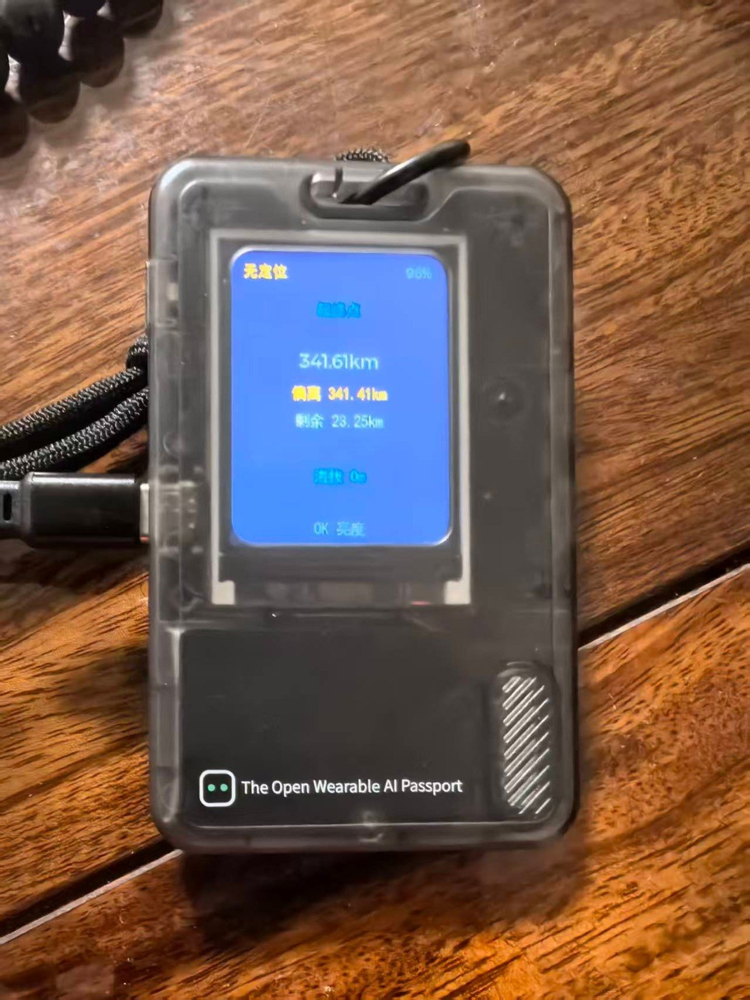
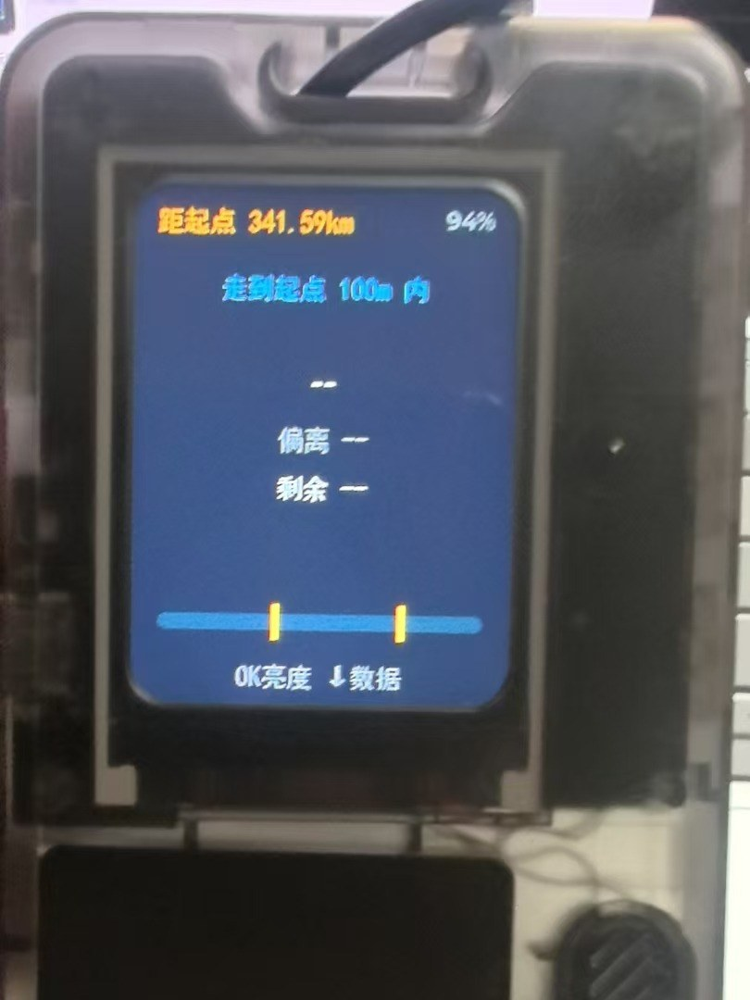
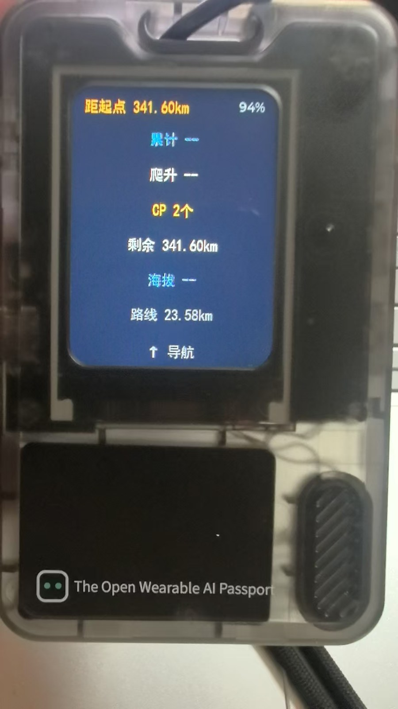
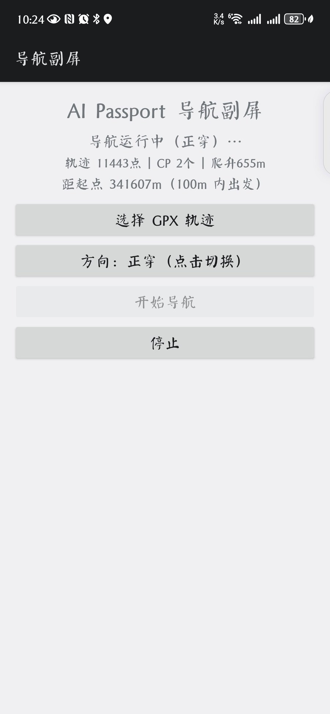

# 越野导航副屏 · Trail Nav Companion

<p align="center">
  
</p>

<p align="center">
  把 AI Passport 变成挂在背包肩带上的越野导航副屏<br>
  离下一个 CP 还有多远 · 有没有偏出轨迹 · 还剩几公里 · 当前海拔多少
</p>

<p align="center">
  <a href="README.en.md">English</a> ·
  <a href="CHANGELOG.md">更新日志</a> ·
  <a href="docs/02-ble-protocol.md">BLE 协议</a> ·
  <a href="docs/03-build.md">构建</a>
</p>

---

## 为什么做这个

越野跑最贵的错误是跑错路——多绕的两公里，往往就是关门时间的缺口。

分岔口、密林、连续爬坡时，掏手机看轨迹既慢又危险：手抬起来挡住视线，脚下还在碎石路上。手机算路很强，但它的屏幕不在你低头就能看到的地方。

这个项目把 AI Passport 卡片变成一块**只看、不算**的副屏：手机在口袋里读 GPX、算距离，卡片通过 BLE 接收结果，你低头一眼就能读到关键数字。

## 功能

| 功能 | 说明 |
|---|---|
| **起点锚定** | 走进起点 100 米内并连续确认两次才开始记录，热身、拍照的里程不会混进成绩 |
| **正穿 / 反穿** | 同一条 GPX 可以反着跑，剩余里程与 CP 顺序都按前进方向调转 |
| **CP 进度条** | 从 GPX 命名航点自动识别 CP（自动排除起点/终点），底部横条显示完成比例，各 CP 位置用琥珀色刻度标出 |
| **到 CP / 到终点** | 大数字显示到下一个 CP 的沿路里程，跑过最后一个 CP 后自动切换成「距终点」 |
| **三档偏离** | 偏出轨迹 30m 内绿色、超过转黄、超过 100m 变红，并响提示音 |
| **无定位保持** | 信号短暂丢失时不清空，保留最后一次读数并转橙色提醒——你知道这行数字是旧的 |
| **累计数据页** | 按上/下键翻页：累计距离、累计爬升、CP 个数、剩余、海拔、路线总长 |
| **数据自查** | 「累计 + 剩余 ≈ 路线总长」，可当场核对有没有算偏 |
| **中文界面** | 自绘 GB2312 点阵字体（7726 字），不依赖系统字库 |

## 界面

<p align="center">
  
  
  
</p>

<p align="center">
  <sub>左：导航页（底部横条 + 2 个 CP 刻度）· 中：数据页 · 右：手机端</sub>
</p>

## 系统组成

```
┌─────────────────────────┐        BLE (GATT)        ┌──────────────────────────┐
│  Android 手机            │  ───────────────────────▶ │  AI Passport 卡片          │
│  · 读 GPX（轨迹+CP+海拔） │  NAV|<fix>|<state>|...    │  ESP32-C3 / 8MB Flash     │
│  · GPS 定位（2s/2m 更新） │                          │  240×320 ST7789 屏        │
│  · 算偏离/剩余/进度/到 CP │ ◀─────────────────────── │  3 键（上/下/OK，ADC 分压）│
│  · 前台服务保持运行       │   STAT (可读，版本串)     │  NimBLE，无 GPS/无震动     │
└─────────────────────────┘                          └──────────────────────────┘
      手机负责"算"                                          卡片负责"看"
```

- **卡片不算任何东西**：没有 GPS、没有地图，只解析 BLE 帧并渲染。这让固件足够小（约 2 MB 合并镜像）、启动足够快。
- **手机不做任何显示决策**：字号、颜色、翻页都在卡片侧，手机只发数据。
- 详细架构见 [docs/01-architecture.md](docs/01-architecture.md)，帧格式见 [docs/02-ble-protocol.md](docs/02-ble-protocol.md)。

## 仓库结构

```
nav-companion/
├── firmware/              ESP-IDF 固件工程（AI Passport 模板的 fork）
│   ├── main/              nav_app / nav_ble / nav_protocol / nav_state / nav_ui / nav_format
│   ├── components/bsp/    板级支持包（屏、按键、音频、电池）
│   ├── tests/             主机侧单元测试（协议解析、格式化、状态机）
│   └── sdkconfig.defaults 默认配置（UTF-8、中文字体）
├── android/               Android App 工程（Kotlin，零第三方依赖）
│   └── app/src/main/java/com/folotoy/navcompanion/
│       ├── MainActivity.kt        选择 GPX / 方向 / 开始停止
│       ├── BleNavService.kt       前台服务：扫描、连接、定位、推帧
│       ├── GpxParser.kt           GPX 解析（trkpt / rtept / wpt）
│       ├── NavEngine.kt           双向导航、CP 规划、进度
│       ├── TrackAccumulator.kt    累计距离/爬升（含噪声过滤）
│       └── NavFrame.kt            BLE 帧构造
├── docs/                  文档与截图
├── tools/                 开发辅助脚本
└── CHANGELOG.md
```

## 快速开始

**不想编译？** 社区玩法页提供现成的合并固件与 App 安装包：

- 玩法页：在 AI Passport 玩法社区搜索「**越野导航副屏**」
- 固件：从玩法页「安装」按钮刷入，或用 [web-flasher](https://ai-passport.folotoy.cn/tools/web-flasher/) 选 `.bin` 从 `0x0` 刷入
- App：见玩法页说明里的网盘链接（Android 12 及以上）

**上手步骤**见 [docs/04-usage.md](docs/04-usage.md)，与玩法页说明一致。

## 从源码构建

### 固件

需要 **ESP-IDF 5.5.3**（与官方模板一致）：

```bash
cd firmware
idf.py set-target esp32c3
idf.py build
idf.py merge-bin -o FoloToy-AI-Passport-full.bin   # 从 0x0 起的合并镜像
```

刷入：

```bash
python -m esptool --chip esp32c3 -p <PORT> -b 460800 write_flash 0x0 FoloToy-AI-Passport-full.bin
```

### Android App

需要 **JDK 17** 与 **Android SDK 34**（`compileSdk 34` / `minSdk 31`）：

```bash
cd android
./gradlew assembleDebug     # 产物：app/build/outputs/apk/debug/app-debug.apk
./gradlew testDebugUnitTest # 运行 JVM 单测
```

依赖只有 Kotlin 标准库与 JUnit（测试期），没有第三方运行时依赖。Gradle 优先走阿里云镜像，官方仓库作为兜底。

更完整的构建说明（含常见报错）见 [docs/03-build.md](docs/03-build.md)。

## 兼容性

| 项 | 状态 |
|---|---|
| 卡片 | AI Passport（ESP32-C3 / 8MB Flash），固件为合并镜像从 `0x0` 刷入 |
| Android 系统 | `minSdk 31`（Android 12）；未使用手机厂商私有 API |
| 已验证机型 | 华为 Mate 60 Pro / HarmonyOS 4.2 |
| GPX 来源 | 两步路、高驰（COROS）、ovitalmap 等标准 GPX 1.0 / 1.1 文件 |
| CP 识别 | 依赖 GPX 里的**命名航点**（`<wpt>` 或带名字的 `<rtept>`），纯轨迹文件没有 CP |

厂商差异主要在**后台保活策略**（见使用说明），BLE 与定位本身走的是标准 API，理论上不需要按机型适配。

## 已知限制

- 卡片没有 GPS 与震动，全部依赖手机的定位与 BLE 连接；手机离得太远会掉线（掉线后卡片显示「等待手机连接」）。
- 不带命名航点的 GPX 不会显示 CP 刻度，此时大数字退化为「距终点」。
- APK 目前是 debug 签名，仅用于侧载安装，未上架应用商店。

## 许可与致谢

- 本项目为 [FoloToy/ai-passport](https://gitee.com/FoloToy/ai-passport) 的衍生应用，固件沿用其 **MIT** 许可；板级支持包（`firmware/components/bsp`）来自上游。
- Android App 同样以 MIT 许可发布，见 [LICENSE](LICENSE)。
- 界面中文字体由 `lv_font_conv` 基于黑体生成，覆盖 GB2312 常用字。
